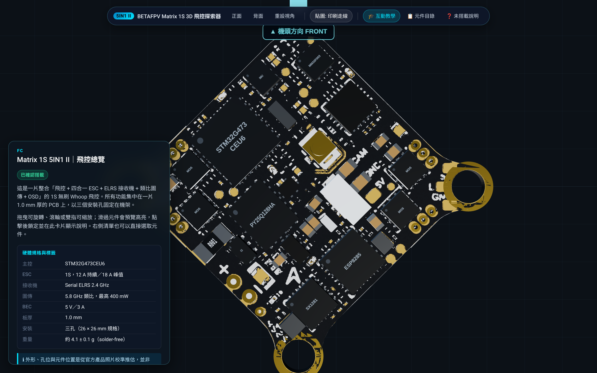
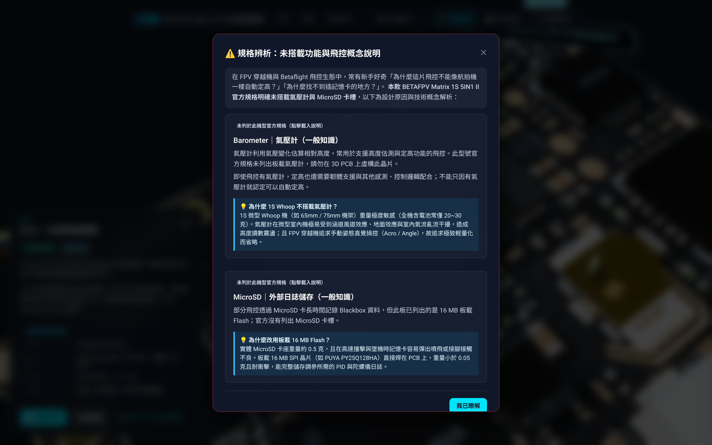

# BETAFPV Matrix 1S Brushless Flight Controller (5IN1 II)
## 互動式 3D PCB 硬體導覽系統 (Interactive 3D PCB Explorer)

[](https://www.typescriptlang.org/)
[](https://threejs.org/)
[](https://vitejs.dev/)
[](https://betafpv.com/products/matrix-1s-5in1-ii-brushless-flight-controller)

專為 **BETAFPV Matrix 1S 無刷飛控 (5IN1 II)** 打造的高仿真、工程級 3D 雙面硬體導覽系統。嚴格依據 BETAFPV 原廠規格與高解析產品圖還原，以正體中文（台灣）提供飛控電子架構、零組件功能定位、飛行知識走讀導覽與未搭載規格釐清。

---

## 📸 視覺驗證與對比預覽 (Visual Verification)

本系統經 Playwright 無頭瀏覽器自動化驗證與渲染截圖，並與原廠標註電路圖進行正反面嚴格對齊：

| 視角 / 功能 | 截圖與驗證 |
| :--- | :--- |
| **正面 3D 視角 vs. 原廠圖** |  |
| **背面 3D 視角 vs. 原廠圖** |  |
| **俯瞰總覽視角 (Overview)** |  |
| **MCU 核心特寫與資訊卡** |  |
| **向量線稿材質切換** |  |
| **互動引導走讀教學 (Tutorial)** |  |
| **未搭載規格說明 (Absent Features)** |  |

---

## 🎯 硬體規格與防偽防呆宣告 (Hardware Target & Guardrails)

本專案**唯一目標**為 **BETAFPV Matrix 1S 5IN1 II (第二代)**，絕非一代 4 孔舊款或 Air 5IN1：

1. **三孔固定幾何 (Three Mounting Holes)**：
   - 採用原廠獨特的「兩側橫向耳部 (左右) + 下方單耳 (後方)」三孔固定佈局（非傳統對稱 4 孔）。
   - 官方標準安裝規格為 $26 \times 26\text{ mm}$ 對角間距（板心至三孔半徑 $H = 26 / \sqrt{2} \approx 18.385\text{ mm}$）。
2. **基板物理厚度 (1.0 mm Extruded Substrate)**：
   - 使用真實 `THREE.ExtrudeGeometry` 實體化 $1.0\text{ mm}$ FR4 複合玻纖板身，邊緣呈現深色玻纖質感與鍍金通孔圓環。
3. **已驗證原廠搭載規格 (Verified Specifications)**：
   - **主控 MCU**：STM32G473CEU6 (高性能 Arm Cortex-M4 @ 170MHz)
   - **陀螺儀 / IMU**：依生產批次裝配 ICM42688P / ICM42622 / BMI270 / LSM6DSK320X
   - **OSD 晶片**：AT7456E 類比字元疊加晶片
   - **黑盒子儲存**：板載 **16 MB SPI Flash**
   - **電子變速器 (ESC)**：1S 12A 持續 / 18A 峰值 4-in-1，配置 4 組 JST1.25 馬達插座
   - **無線遙控接收**：板載 Serial ExpressLRS 2.4GHz (SX1280 + ESP8285 架構)
   - **圖傳發射 (VTX)**：板載 5.8GHz 400mW 類比圖傳，配置金屬屏蔽罩與 U.FL 天線端子
   - **調參介面**：SH1.0-4Pin 超小型插座（非板載直焊式 USB-C 座）
   - **電源輸入**：BT2.0 高性能 1S 電源接頭
4. **未搭載規格嚴格釐清 (Explicitly Absent Components)**：
   - ❌ **氣壓計 (Barometer)**：原廠規格明確未列出，**模型上絕不虛構氣壓晶片**。
   - ❌ **MicroSD 卡槽**：本機已配備 16 MB 板載 Flash，官方未列出且未設計 SD 卡槽。
   - 兩者收錄於導覽列之「未搭載說明」對話框與側邊目錄，標註狀態「`未列於此機型官方規格`」，並詳細解說其在無人機領域之原理。

---

## ✨ 核心互動功能 (Key Features)

- **物理級真實渲染 (PBR Materials)**：
  - 消光黑防焊阻焊層 (Solder Mask)、沉金焊盤 (ENIG Pads)、陶瓷微型電容 (MLCC)、環氧樹脂晶片封裝 (IC Epoxy) 與尼龍 JST 插座。
- **雙材質切換模式 (Texture Mode Toggle)**：
  - 📷 **高解析實拍照片 (Photorealistic)**：原廠高解像度產品照片經單應性 (Homography) 透視校正之實拍質感。
  - 📐 **向量印刷線稿 (Vector Artwork)**：高對比電路走線、焊盤金環與白絲印向量重建風格。
- **遮蔽感知拾取演算法 (Occlusion-Aware Raycasting)**：
  - 透過計算光線穿越外殼之空間相交深度，徹底杜絕穿透不透明 PCB 板身誤選背面元件之問題。
- **非破壞性光暈選取 (Non-destructive Highlighting)**：
  - 游標懸停 (Hover) 泛藍冷光微亮，點擊鎖定 (Select) 呈現天藍色外框與發光脈衝，不破壞材質實體屬性。
- **固定式左下資訊卡 (Fixed Bottom-Left Info Card)**：
  - 固定於畫面左下角，符合規格指引，不隨視角晃動。
  - 顯示元件正體中文全名、硬體狀態標籤（`已確認搭載`、`型號依批次不同`、`推估位置`、`未列於此機型官方規格`）、2~4 句功能詳解、關鍵參數對照表與飛手實務提醒。
- **相機平滑運鏡 (Smooth Macro Camera Transitions)**：
  - 點擊「定位元件」或在元件目錄點選，視角自動帶平滑立方緩動 (Cubic Easing) 推進至元件上方最佳觀察距離。
- **12 步驟互動走讀教學 (Guided Interactive Tutorial)**：
  - 循序引導飛手從「機頭方向」、「主控 MCU」、「陀螺儀姿態感測」、「16MB 黑盒子」、「四合一電調與馬達」、「5.8G 圖傳」、「ELRS 接收」、「OSD 晶片」、「SH1.0 介面」到「未搭載規格剖析」，搭配導覽進度指示與鏡頭自動導引。

---

## 📐 座標系統與空間定義 (Coordinate Conventions)

- **長度單位**：$1\text{ Three.js Unit} = 1.0\text{ mm}$。
- **板身平面**：水平置於 **X-Z 平面**，厚度沿 Y 軸置中（頂面 $Y = +0.5\text{ mm}$，底面 $Y = -0.5\text{ mm}$）。
- **機頭方向**：飛控本地向前方向定義為 **-Z 軸**（對應畫面初載入之上方）。
- **背面手性鏡像變換**：
  - 背面元件安裝嚴格依據旋轉角度進行空間轉換，避免使用負縮放導致法線翻轉與晶片絲印鏡像文字反向。
- **固定孔中心座標**：
  - 左側固定孔：$(X, Z) = (-18.385, 0)\text{ mm}$
  - 右側固定孔：$(X, Z) = (+18.385, 0)\text{ mm}$
  - 後方固定孔：$(X, Z) = (0, +18.385)\text{ mm}$

---

## 📁 專案架構 (Project Structure)

```text
fc_overview/
├── public/
│   ├── assets/                # 幾何輪廓與透視校正雙面貼圖 (Rectified Textures & Artwork)
│   │   ├── top_photo.jpg
│   │   ├── bottom_photo.jpg
│   │   ├── top_artwork.png
│   │   └── bottom_artwork.png
│   └── references/            # 原廠下載圖資與來源對照文檔
│       ├── top_front_labeled.jpg
│       ├── bottom_front_labeled.jpg
│       ├── solderfree_front.jpg
│       ├── solderfree_back.jpg
│       └── SOURCE.md          # 原廠網址、CDN 簽章與下載記錄
├── src/
│   ├── data/
│   │   ├── boardSpec.ts       # 官方規格常數與板身尺寸
│   │   ├── components.ts      # 正體中文技術百科與規格資訊字典
│   │   ├── placement.ts       # 3D 空間佈局與置信度 (Confidence Level)
│   │   └── generated/
│   │       ├── outline.json   # 80 節點三孔板身多邊形頂點
│   │       └── passives.json  # 數十顆 SMT MLCC 被動元件座標與尺寸
│   ├── scene/
│   │   ├── setupScene.ts      # 場景、燈光、陰影與相機初始化
│   │   ├── materials.ts       # PBR 材質庫 (FR4, 金, 錫, 晶片膠體, 尼龍)
│   │   ├── createPCB.ts       # 1.0mm 3 孔基板擠出與 UV 表面層
│   │   ├── createComponents.ts# 3D QFN/LGA 封裝、引腳、被動元件與天線座
│   │   ├── createConnectors.ts# JST1.25 馬達座 (含針腳插槽) & SH1.0 USB 連接器
│   │   ├── forwardArrow.ts    # 3D 機頭指向箭頭與脈衝動畫
│   │   ├── cameraControls.ts  # OrbitControls 與平滑相機動畫
│   │   ├── picking.ts         # 遮蔽感知射線拾取
│   │   └── highlight.ts       # 發光與選取狀態管理
│   ├── ui/
│   │   ├── infoCard.ts        # 固定式左下詳細資訊卡
│   │   ├── toolbar.ts         # 頂部玻璃擬態快捷工具列
│   │   ├── tutorial.ts        # 12 步互動教學步進導覽
│   │   └── glossary.ts        # 全元件清單抽屜與未搭載規格彈窗
│   ├── main.ts                # 主程式入口與事件調度
│   └── styles.css             # 現代半透明科技感 UI 樣式表
├── tools/
│   ├── extract_assets.py      # 原廠照片單應性透視校正與多邊形萃取
│   ├── screenshots.mjs        # Playwright 自動化無頭測試與多角度驗證截圖
│   ├── generate_comparison.py # 自動產生 3D 模型與原廠圖並排對照圖
│   └── screenshots/           # 視覺驗證產出圖庫
├── Justfile                   # 專案任務管理腳本 (支援 just 指令)
├── REFERENCE_NOTES.md         # 原廠硬體對照與推估說明備忘錄
├── guideline.md               # 專案規格需求指引
└── package.json
```

---

## 🚀 快速上手 (Getting Started)

本專案支援使用 [`just`](https://github.com/casey/just) 任務管理器或標準 `npm` 指令進行管理。

### 1. 環境需求
- [Node.js](https://nodejs.org/) v18.0.0 以上
- [just](https://github.com/casey/just) 命令列工具（選用但推薦）
- [Python 3](https://www.python.org/)（選用，用於重新執行圖資萃取或截圖拼圖腳本，需裝 `Pillow`）

### 2. 使用 Justfile 便捷管理（推薦）
```bash
# 查看所有可用指令
just

# 安裝相依套件
just install

# 啟動開發伺服器
just dev

# 型別檢查與生產打包
just build

# 執行自動化測試與截圖生成
just screenshots

# 產生側面對照圖
just compare

# 一鍵執行全流程驗證 (typecheck + build + screenshots + compare)
just verify
```

### 3. 使用標準 npm 指令
```bash
# 安裝相依套件
npm install

# 啟動本機開發伺服器 (預設運行於 http://localhost:5173)
npm run dev

# 執行 TypeScript 靜態型別檢查與 Vite 打包
npm run build

# 本機預覽生產打包成品
npm run preview
```

### 4. 執行自動化測試與截圖生成
```bash
# 啟動無頭 Chrome 執行全流程功能點擊測試並自動產出 9 張展示截圖
node tools/screenshots.mjs

# 執行側面對照圖合成腳本
python3 tools/generate_comparison.py
```

---

## 🔬 置信度與數據聲明 (Data Confidence Declaration)

在 `src/data/placement.ts` 中，每項空間定義均嚴格標註其置信等級：

- **`verified` (官方確認)**：
  - 三孔安裝對角距離 $26\text{ mm}$、基板厚度 $1.0\text{ mm}$、主要 IC 型號（STM32G473、AT7456E、16MB Flash 等）、4 組 JST1.25 接頭配置、SH1.0-4P 介面。
- **`estimated_from_photo` (照片幾何推估)**：
  - 各晶片中心 $(X, Z)$ 毫米座標係藉由原廠正反面產品照片進行透視單應性校正後測得，非原廠發布之官方 CAD / Gerber 檔案。
  - 板身外框邊緣凹凸幾何係依據照片高對比度輪廓萃取，提供逼真外觀，但不應作為工業模具或精密機架切割之依據。
- **`illustrative` (示意性質)**：
  - 數十顆 0402 / 0603 SMT 陶瓷電容與微型電阻群係根據表面照片密集分佈處生成，數值與內部多層板走線未公開。

---

## 📜 授權與圖資來源聲明 (References & Sources)

- BETAFPV 官方產品網址：[BETAFPV Matrix 1S 5IN1 II Brushless Flight Controller](https://betafpv.com/products/matrix-1s-5in1-ii-brushless-flight-controller)
- 圖資版權與下載鏈結詳見 [`public/references/SOURCE.md`](public/references/SOURCE.md)。
- 本專案代碼採 MIT 授權釋出，僅供硬體工程導覽與教育學習使用。
