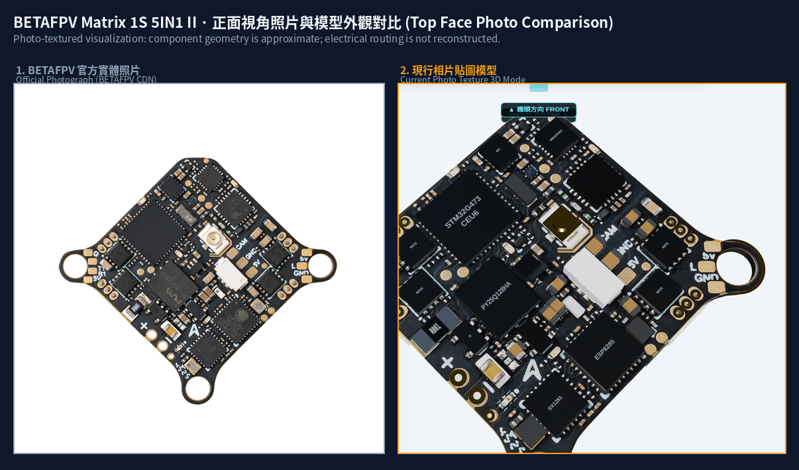
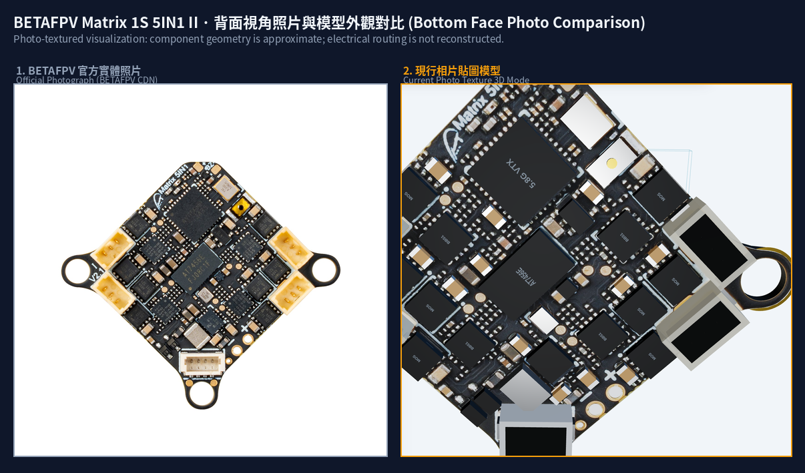
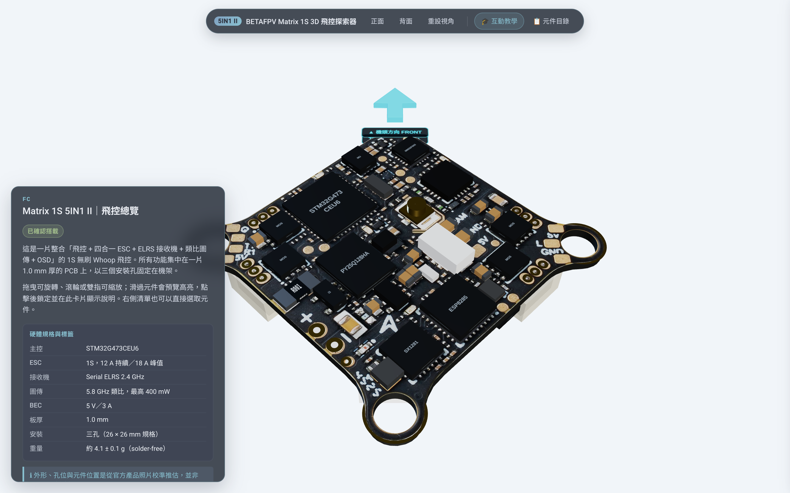
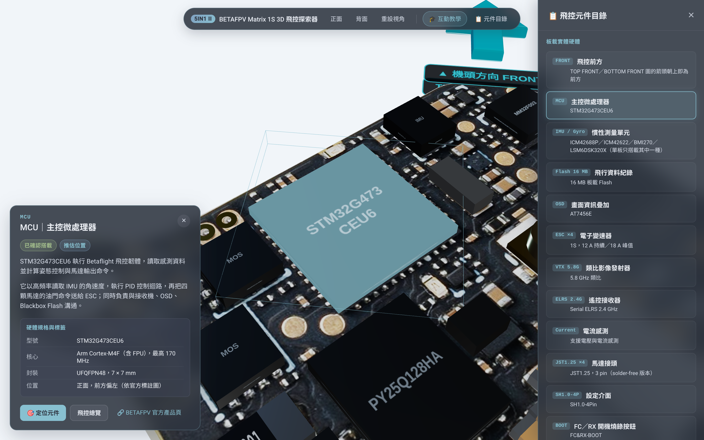
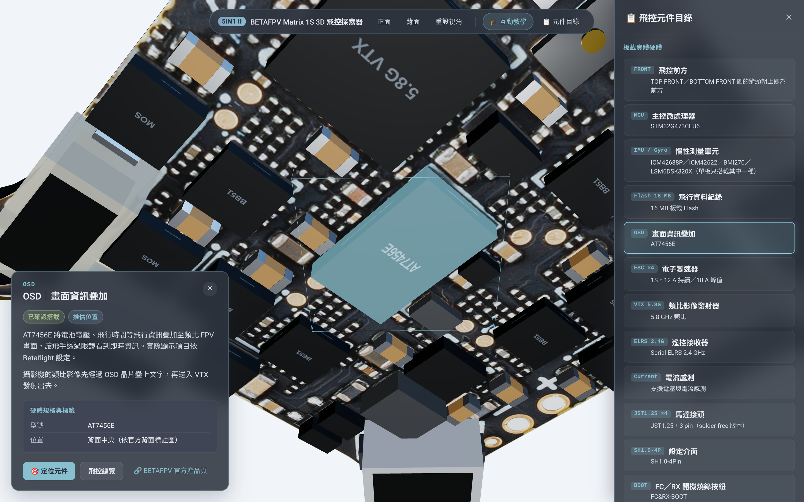
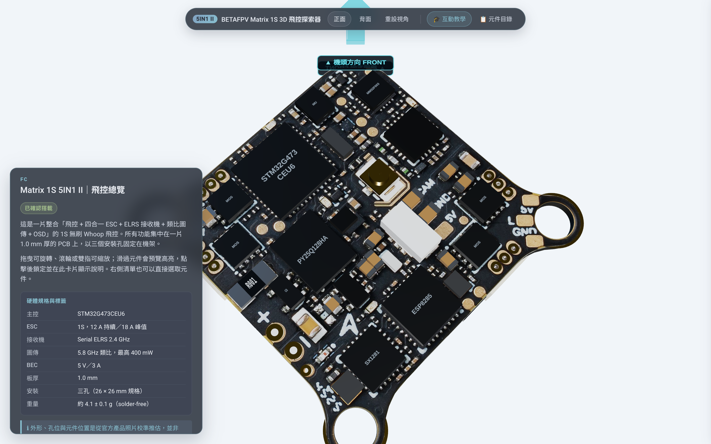
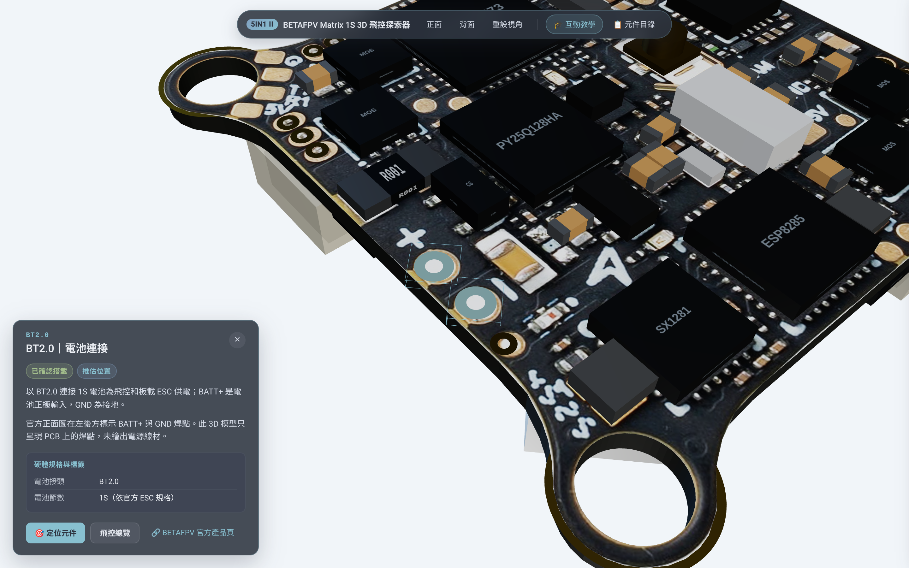
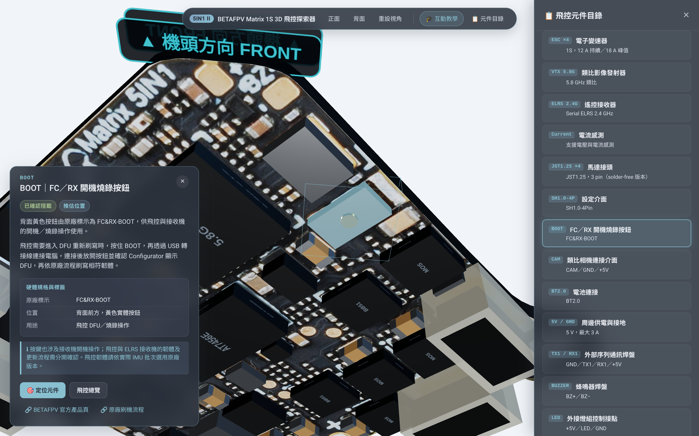
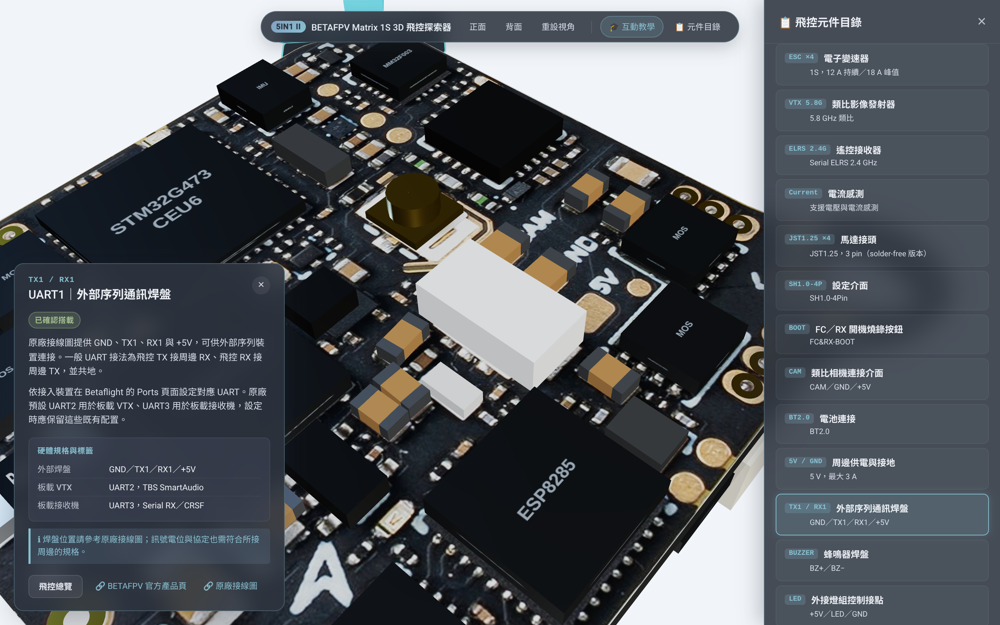
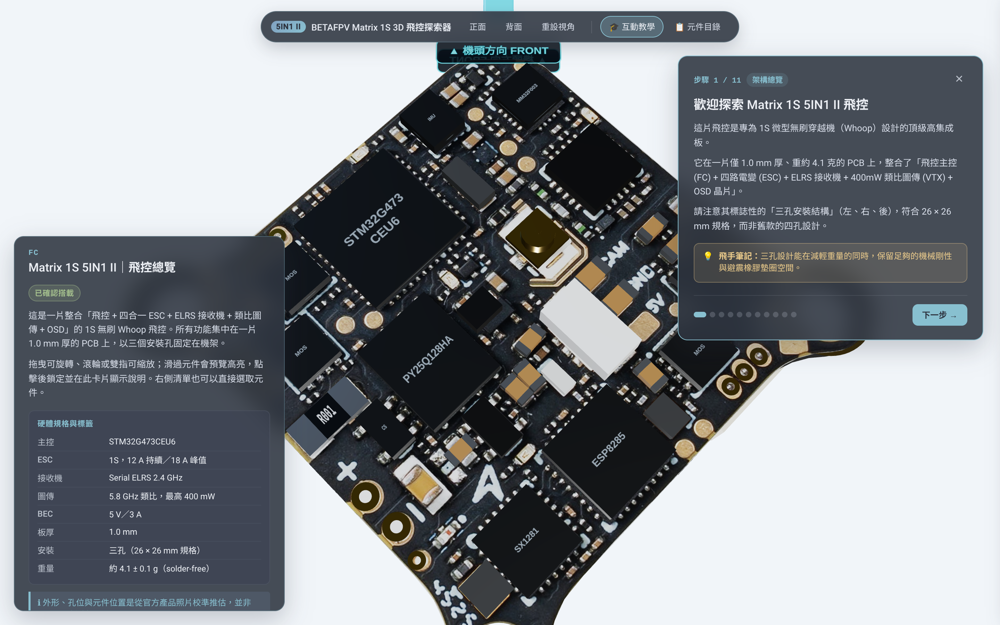

# BETAFPV Matrix 1S Brushless Flight Controller (5IN1 II)
## Interactive 3D PCB Web Explorer

[](https://opensource.org/licenses/MIT)
[](https://www.typescriptlang.org/)
[](https://threejs.org/)
[](https://vitejs.dev/)
[-brightgreen)](https://betafpv.com/products/matrix-1s-5in1-ii-brushless-flight-controller)

A photo-referenced, double-sided **Three.js PBR 3D visualization** and interactive hardware explorer for the **BETAFPV Matrix 1S Brushless Flight Controller (5IN1 II)**. Uses official BETAFPV documentation and product photos for hardware identification. Component positions, 3D shapes, and material parameters are visual approximations, not verified manufacturing data. Visible IC contacts require explicit sourced geometry. Both PCB faces always use rectified manufacturer photographs. Features educational hardware annotations and an interactive walk-through tutorial in Traditional Chinese (正體中文).

---

## 📸 Visual Verification & Comparison

The 3D model and interactive features have been automatically validated using headless Chromium via Playwright:

| View / Feature | Preview & Visual Evidence |
| :--- | :--- |
| **Top Face Photo Comparison** |  |
| **Bottom Face Photo Comparison** |  |
| **Perspective Overview (Photo Texture)** |  |
| **MCU Macro Focus & Info Card** |  |
| **Bottom View & AT7456E OSD** |  |
| **Photographic Texture Mode** |  |
| **BT2.0 Battery Pad Highlight** |  |
| **BOOT Button & Firmware Entry** |  |
| **UART1 Wiring Reference** |  |
| **Interactive Guided Tutorial** |  |

---

## 🎯 Hardware Target & Specification Guardrails

This project strictly models the **5IN1 II (Second Generation)**, and deliberately rejects conflation with older 4-hole or Air 5IN1 flight controllers:

1. **Distinctive 3-Hole Substrate Geometry**:
   - Accurately models the asymmetric 3 mounting holes (two lateral ear tabs, one rear tab; diagonal spacing $26 \times 26\text{ mm}$, radius $H = 26/\sqrt{2} \approx 18.385\text{ mm}$).
2. **True 1.0 mm Extruded Substrate**:
   - Physically extruded FR4 fiberglass core ($1.0\text{ mm}$ thickness) with dark composite edges, gold-plated hole rims, and top/bottom solder mask plates.
3. **Confirmed Onboard Hardware (Official Listing)**:
   - **MCU**: STM32G473CEU6 (Arm Cortex-M4 @ 170MHz)
   - **Gyro / IMU**: Production batch-dependent (ICM42688P / ICM42622 / BMI270 / LSM6DSK320X)
   - **OSD**: AT7456E analog monochrome OSD
   - **Blackbox**: **16 MB onboard SPI Flash** (PY25Q128HA)
   - **ESC**: 4-in-1 1S 12A continuous / 18A peak with 4× JST1.25 motor sockets
   - **Receiver**: Serial ExpressLRS 2.4 GHz (SX1280/SX1281 RF + ESP8285 MCU)
   - **VTX**: Integrated 5.8 GHz 400mW analog video transmitter with U.FL antenna jack
   - **USB Interface**: SH1.0-4Pin micro-connector (not an onboard direct USB-C socket)
   - **Battery**: BT2.0 1S power leads
4. **Visualization Limits**:
   - Both PCB faces use manufacturer photographs; there is no synthetic PCB texture mode or electrical overlay.
   - Component shapes and positions are photo-based approximations, not verified CAD.
   - ICs without documented package geometry use simplified bodies without invented contacts or pin-1 marks. `src/data/footprints.ts` defines sourced visible-contact geometry; no production IC definitions are currently enabled.
   - Photos cannot establish hidden pads, internal layers, or electrical connectivity. Material settings describe appearance, not measured hardware properties.

---

## ✨ Key Features

- **Manufacturer Photo Textures**:
  - Both board faces display perspective-rectified product photographs. The app has no texture-mode switch or comparison modal. `just compare` generates offline source-photo/model comparisons for visual inspection.
- **Occlusion-Aware Raycast Picking**:
  - Raycaster accounts for opaque substrate intersections, completely eliminating accidental picking of back-face chips through the board.
- **Nord Information Cards**:
  - Nord Polar Night panels use 88% opacity with backdrop blur, Snow Storm text, and Frost accents. The bottom-left card displays Traditional Chinese hardware titles, status badges (`已確認搭載`, `型號依批次不同`, `推估位置`), functional descriptions, verified specs table, and camera focus shortcuts.
- **Connector Selection & Highlights**:
  - Selecting a connector on the board highlights that placement; selecting a catalog group highlights each modeled placement with its own Nord Frost outline. BT2.0 highlights the BATT+/GND solder pads shown in the model. Flat pads use depth bias to stay visible above the photo surface.
- **Component Catalog Drawer with Active Highlights**:
  - Sidebar drawer allows pilots to browse all components; stays open during browsing with persistent active selection highlights. Confirmed interface cards cover BOOT, camera input, 5V/GND power, UART1, buzzer pads, and LED connections. Cards for pads without modeled geometry link to the manufacturer wiring diagram.
- **11-Step Guided Educational Tutorial**:
  - Step-by-step interactive walk-through covering coordinate conventions, core chips, RF systems, ESC power stages, and onboard sensors.
- **Gimbal-Lock Free Camera Navigation**:
  - Smooth cubic-eased camera transitions for front, bottom, reset, and component macro-views with singularity-protected polar clamps.

---

## 📐 Coordinate Conventions

- **Units**: $1\text{ Three.js unit} = 1.0\text{ mm}$.
- **Orientation**: PCB rests in the **X-Z plane**, thickness centered on Y = 0 (top face at $Y = +0.5\text{ mm}$, bottom face at $Y = -0.5\text{ mm}$).
- **Local Forward**: Defined as **-Z axis** (pointing toward the top of the screen in default view).
- **Bottom Face Handedness**:
  - Bottom components are positioned with genuine rotation rather than negative scaling, preserving correct surface normals and left-to-right text readability.
  - Bottom camera view places the nose (-Z) toward the top of the screen, perfectly matching the official BETAFPV `BOTTOM FRONT` reference map.

---

## 📁 Project Structure

```text
fc_overview/
├── Justfile                   # Task runner script (just command-line automation)
├── LICENSE                    # MIT License (Jason Kuan)
├── README.md                  # Project documentation (English)
├── REFERENCE_NOTES.md         # Reference alignment and photo estimation notes
├── guideline.md               # Original implementation specifications
├── index.html                 # Web app shell
├── package.json
├── public/
│   ├── assets/                # Rectified manufacturer photo textures
│   │   ├── top_photo.jpg
│   │   └── bottom_photo.jpg
│   └── references/            # Original manufacturer downloads & URL audit
│       ├── top_front_labeled.jpg
│       ├── bottom_front_labeled.jpg
│       ├── solderfree_front.jpg
│       ├── solderfree_back.jpg
│       ├── connection_diagram.jpg # Official peripheral wiring reference
│       └── SOURCE.md
├── src/
│   ├── data/
│   │   ├── boardSpec.ts       # Board dimensions, hole coordinates, specs
│   │   ├── components.ts      # Hardware metadata & Traditional Chinese catalog
│   │   ├── placement.ts       # 3D component coordinates & confidence levels
│   │   └── generated/
│   │       ├── outline.json   # 80-vertex 3-hole polygon outline
│   │       └── passives.json  # Surface-mount passive arrays
│   ├── scene/
│   │   ├── setupScene.ts      # Scene, camera, studio lighting & renderer
│   │   ├── materials.ts       # Three.js PBR materials (FR4, gold, solder, IC epoxy, nylon)
│   │   ├── createPCB.ts       # 1.0 mm 3-hole extruded substrate & face finishes
│   │   ├── createComponents.ts# 3D IC packages, leads, silkscreens, passives
│   │   ├── createConnectors.ts# JST1.25 motor plugs, SH1.0 USB header, U.FL jack
│   │   ├── forwardArrow.ts    # 3D nose indicator with animated billboard
│   │   ├── cameraControls.ts  # OrbitControls & smooth easing camera transitions
│   │   ├── picking.ts         # Occlusion-aware raycaster
│   │   └── highlight.ts       # Non-destructive emissive glow & accent boxes
│   ├── ui/
│   │   ├── infoCard.ts        # Fixed bottom-left HUD card
│   │   ├── toolbar.ts         # Top frosted glass navigation toolbar
│   │   ├── tutorial.ts        # 11-step guided interactive walkthrough
│   │   └── componentDrawer.ts # Onboard component drawer
│   ├── main.ts                # Application bootstrap & event orchestration
│   └── styles.css             # Glassmorphism UI stylesheet
└── tools/
    ├── extract_assets.py      # Homography rectification & outline extraction
    ├── screenshots.mjs        # Playwright headless browser test suite
    ├── generate_comparison.py # Side-by-side validation image generator
    └── screenshots/           # Generated verification imagery
```

---

## 🚀 Quick Start

### Prerequisites
- [Node.js](https://nodejs.org/) v18.0.0 or higher
- [just](https://github.com/casey/just) command runner (optional, recommended)
- [Python 3](https://www.python.org/) with `Pillow` (optional, for asset extraction or comparison scripts)

### Managing with Justfile (Recommended)
```bash
# List all available recipes
just

# Install npm dependencies
just install

# Start local development server (http://localhost:8080)
just dev

# Run TypeScript typecheck and build production bundle
just build

# Preview production build locally
just preview

# Check IC geometry, photo loading, and texture disposal (requires Chrome)
npm run check:hardware

# Run automated browser test and capture UI screenshots
just screenshots

# Generate side-by-side visual comparisons against official photographs
just compare

# Run complete verification suite (typecheck + build + screenshots + compare)
just verify

# Clean build artifacts
just clean
```

### Managing with Standard npm Commands
```bash
npm install
npm run dev
npm run build
npm run preview
npm run typecheck
```

---

## 🔬 Data Confidence Declaration

In [`src/data/placement.ts`](src/data/placement.ts), every 3D coordinate is classified by confidence:

- **`verified`**: Three mounting holes ($26\text{ mm}$ diagonal), board thickness ($1.0\text{ mm}$), official IC part numbers (STM32G473, AT7456E, 16MB Flash, etc.), 4× JST1.25 motor connectors, SH1.0-4P USB connector.
- **`estimated_from_photo`**: Component XY center coordinates derived from 3-hole homographic perspective rectification of official product photos.
- **`illustrative`**: Dense arrays of 0402 / 0603 SMT ceramic capacitors and pull-up resistors approximated from surface photos.

---

## 📄 License & Attribution

- **Software License**: [MIT License](LICENSE) © 2026 **Jason Kuan (jason9075)**.
- **Hardware Reference**: [BETAFPV Matrix 1S Brushless Flight Controller (5IN1 II)](https://betafpv.com/products/matrix-1s-5in1-ii-brushless-flight-controller).
- **Product Photos & Diagrams**: Retained under fair-use reference and educational research guidelines; original sources documented in [`public/references/SOURCE.md`](public/references/SOURCE.md).
